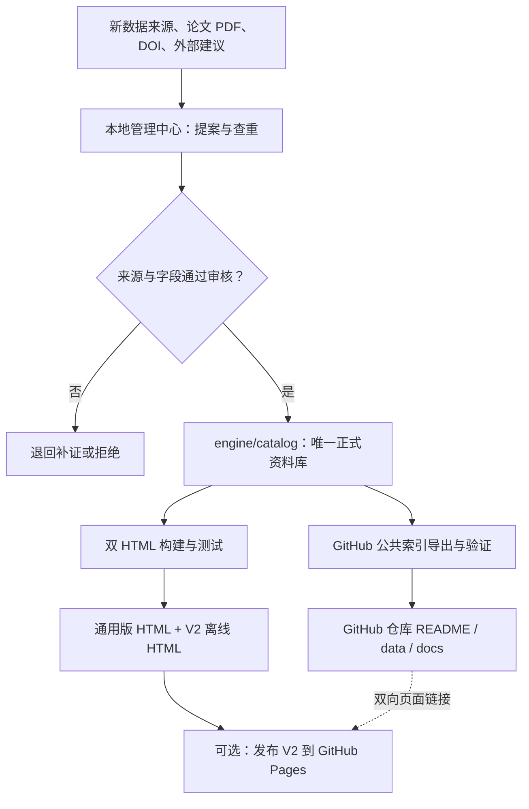

# ADV·BATTERY GitHub 公开目录长期维护与 V2 联动指南 V1.0

> **适用对象：** ADV·BATTERY 电池数据资源公开索引仓库 + 本地双版本 HTML 维护工程。  
> **依据：** 2026-11-06 生成的 `ADV_BATTERY_GitHub_Ready_80_Resources.zip`（共 24 个上传文件）及 `v1.2.2-gh41-ui-20261106` 本地工程。  
> **核心原则：** 一个正式资料库、多种发布成果；先审核、再构建、再发布；可追踪、可回滚、不因维护而丢失旧数据。  
> **注意：** 本文介绍当前真实能力和建议改造方案，不代表 GitHub Pages、双向链接或自动同步已经部署成功。

**仓库内导航：** [返回中文首页](../README.md) · [现有基础维护说明](MAINTENANCE.md) · [字段说明](FIELDS.md) · [首次上传指南](GITHUB_UPLOAD_GUIDE_ZH.md) · [投稿规范](../CONTRIBUTING.md)。

---

## 0. 先看结论：两个项目各负责什么

**我的推荐：将本地 `engine/catalog/` 作为唯一正式数据源；把 GitHub 定位为公开索引与版本协作窗口；把 V2 定位为检索、筛选、文献关联与个人科研工作的交互前端。**

| 系统 | 主要任务 | 允许修改什么 | 不应该做什么 |
|---|---|---|---|
| 本地 ADV·BATTERY 管理中心 | 导入、去重、校验、审核、保管正式资料 | `engine/catalog/`（经后台审核） | 不经审核直接覆盖正式数据 |
| 手机电脑通用版 HTML | 便携浏览、分享 | 由同一正式资料库构建 | 在生成后的 HTML 内手动增加数据 |
| V2 科研工作台 HTML | 搜索、关联文献、研究标签、收藏和个人笔记 | 修改 V2 页面代码；数据仍来自正式资料库 | 将个人笔记误认为可提交的公共数据 |
| GitHub 公开目录 | 对外介绍、80 条资源索引、论文表格、接受纠错与投稿、查看历史 | 从正式资料库**导出的白名单公开内容** | 公开后台、草稿、第三方原始电池文件或密钥 |
| GitHub Pages（可选） | 托管 V2 在线版 | 发布经过检查的静态 `index.html` | 把页面上线等同于后台自动同步或多人数据库 |

**建议数据流：**



> 这里的“双向链接”指页面之间的导航连接，不代表可以从 GitHub 直接回写管理中心。

## 1. 当前版本和公开统计口径

这份 GitHub 上传包的 `data/catalog_info.json` 写明：

- **资源总数 80**：76 条实验数据集 + 3 个数据门户 + 1 个工具；不是 80 份可直接下载的原始数据文件。
- **文献及目录记录 108**：包含正式论文及数据目录记录，不应一概叫作 108 篇经独立核验的论文。
- **已登记关联 69**：审核状态不完全相同，不应理解为 69 条全部独立核实。
- **8 个研究方向标签**：`SOC / SOH / RUL / EIS / FAST / FIELD / MODEL / SAFETY`。
- **41 条外部来源映射**：与 `PythoniLover/battery-dataset-collection` 的社区目录对照，其中 14 条复用原有资源、26 条新增资源、1 条登记为独立版本。

这些是**初始快照**的统计值。以后新增、合并、修改后，应以**自动生成的** `data/catalog_info.json` 为准，不手动维护固定数字。

## 2. GitHub 仓库完整结构与每个文件的作用（24 个）

以下文件名均来自实际上传 ZIP，不是建议中凭空添加的文件。

```text
ADV-BATTERY-Dataset-Collection/
├── README.md
├── README_EN.md
├── CONTRIBUTING.md
├── NOTICE.md
├── .gitignore
├── .github/
│   ├── ISSUE_TEMPLATE/
│   │   └── new-dataset.md
│   └── workflows/
│       └── validate.yml
├── data/
│   ├── catalog_info.json
│   ├── datasets.json
│   ├── datasets.csv
│   ├── papers.json
│   ├── papers.csv
│   ├── relations.json
│   ├── relations.csv
│   └── source_41_mapping.csv
├── docs/
│   ├── DATASET_DETAILS.md
│   ├── TOPICS.md
│   ├── PAPERS.md
│   ├── SOURCE_41_MAPPING.md
│   ├── FIELDS.md
│   ├── MAINTENANCE.md
│   └── GITHUB_UPLOAD_GUIDE_ZH.md
└── scripts/
    ├── build_public_index.py
    └── validate_public_index.py
```

### 2.1 根目录（5 个文件）

| 文件 | 具体内容和用途 | 维护方式 |
|---|---|---|
| `README.md` | 仓库**中文首页**：项目说明、统计、80 条资源表、研究分类、文献入口 | **自动生成**；不要只改表格或数字，更新正式数据后重建 |
| `README_EN.md` | 与中文首页对应的英文介绍和资源总表 | **自动生成**，保持与中文表格同一数据口径 |
| `CONTRIBUTING.md` | 外部贡献指南：如何提供数据集、论文、来源证据、许可与建议 | 仅当投稿流程变化时谨慎修改；不要写入个人信息 |
| `NOTICE.md` | 来源致谢、原始数据版权/许可提醒和公开数据边界 | 生成器可能根据数据与时间更新；对许可用语应人工审核 |
| `.gitignore` | 阻止上传临时文件、虚拟环境、密钥、PDF、压缩包、后台工程等 | 仅维护规则时修改；**它不保证曾提交过的敏感文件自动消失** |

### 2.2 `.github/`（2 个文件）

| 文件 | 用途 | 改动和注意事项 |
|---|---|---|
| `.github/ISSUE_TEMPLATE/new-dataset.md` | GitHub 用户点 New issue 时使用的**新数据集建议表单**，提醒填写官方链接、DOI、证据等 | 可按需优化问题项；提交的 Issue **不会自动进入正式资料库** |
| `.github/workflows/validate.yml` | GitHub Actions：推送或 PR 改动相关路径后，自动运行公开目录的一致性检查 | **当前只验证公开索引**，不会自动更新本地 V2，也不会发布 GitHub Pages |

### 2.3 `data/`（8 个文件）

| 文件 | 具体作用 | 推荐管理方式 |
|---|---|---|
| `catalog_info.json` | 当前导出日期、数据来源、数据集/门户/工具、论文、关联数量等**统计元信息** | 生成器维护；不要手动改数字 |
| `datasets.json` | 80 条资源的结构化数据，包括稳定 ID、名称、机构、来源 URL、获取入口、标签、实验说明等 | 由 `engine/catalog/` 白名单导出；作为 GitHub 当前公开快照的基础数据 |
| `datasets.csv` | 上一文件的表格版，便于 Excel、筛选和检索 | 自动导出；不要与 JSON 各改一遍 |
| `papers.json` | 108 条论文/目录记录，含标题、DOI、链接、类型、关联资源 ID | 由正式资料库导出；勿虚构 DOI |
| `papers.csv` | 上一文件的 Excel 友好版 | 自动导出；文件采用 UTF-8 with BOM |
| `relations.json` | 69 条数据集与文献关系，含 `dataset_id`、`paper_id`、关系类型与审核状态 | 由正式资料库导出；编辑前先检查稳定 ID 存在 |
| `relations.csv` | 关联关系表格版 | 自动导出 |
| `source_41_mapping.csv` | 本项目对原 41 条 GitHub 数据索引的去重对应关系（来源编号、内部 ID、处理结论） | 追踪与致谢用，**不是需要每次补新数据就新增一行的总表** |

JSON 更适合程序使用，CSV 更适合人工检查；两者应始终由同一次构建产生。

### 2.4 `docs/`（7 个文件）

| 文件 | 具体作用 | 推荐管理方式 |
|---|---|---|
| `DATASET_DETAILS.md` | 每条数据集的详细说明、来源、数据入口和已登记信息 | 自动生成；在正式数据中修正描述后重新导出 |
| `TOPICS.md` | SOC、SOH、RUL、EIS、快充、实车、建模、安全八大类的标签索引 | 自动生成；任务标签要有依据，不能按标题任意推断数据字段 |
| `PAPERS.md` | 108 条文献与目录记录的列表、DOI/链接信息 | 自动生成；论文和数据仓库 DOI 不可混淆 |
| `SOURCE_41_MAPPING.md` | 原 41 条来源与本地 80 条资源之间的对应关系说明 | 自动生成，用于去重追踪 |
| `FIELDS.md` | 公共 JSON/CSV 字段定义，如 `id`、`resource_type`、`access_url`、`research_tags` | 数据模型变化时更新解释 |
| `MAINTENANCE.md` | 原包内的公开仓库**基础维护流程**及更新命令 | 本文是它的扩展版；优先读本文的 V2 连接方案 |
| `GITHUB_UPLOAD_GUIDE_ZH.md` | 首次在 GitHub 网页上传这 24 个文件的步骤 | 首次上传时使用，后续主要用 GitHub Desktop 或 Git 命令 |

### 2.5 `scripts/`（2 个文件）

| 文件 | 功能 | 是否修改 |
|---|---|---|
| `build_public_index.py` | 从**正式本地资料库**或当前公开 JSON 读取数据，重建 README、文献详情、分类页和 CSV 等 | 平时只**运行**，不要每次新增数据都改 Python 代码 |
| `validate_public_index.py` | 检查数据数量、关系、CSV/JSON 一致、Markdown 链接、敏感目录和 URL 格式 | 平时只运行；字段规则变化时才修改并补回归测试 |

**区分“可人工编辑”和“生成文件”：** 首页、详细页、分类页和 CSV 是**发布产物**；修改资料应进入正式资料库，不要长期在多处手工维护同一条记录。

## 3. 文件之间的关系：改一次为何能更新多处？

1. 正式资料库 `engine/catalog/datasets.json` 保存完整资源登记。
2. `engine/catalog/papers.json` 保存文献；`engine/catalog/relations.json` 保存明确对应关系；`tags.json` 等提供标签及其他内容。
3. 本地管理中心审核完成后，`engine/scripts/build.py` 从正式资料库构建**两个网站**。
4. 独立 GitHub 索引项目的 `scripts/build_public_index.py --catalog ... --write` 从相同正式目录提取**允许公开的字段**，更新 `data/`、`README` 和 `docs/`。
5. GitHub 公开索引通过 `validate_public_index.py` 和 GitHub Actions 进行内部一致性检查；最后提交到 GitHub。

**当前不具备的能力：** 本地资料库改变后 GitHub 不会自动变化；在 GitHub 网页直接修改数据也不会自动写回本地管理中心或 V2。这两边目前没有真正的实时双向数据库同步功能。

## 4. 日常新增一条数据集：完整 SOP（推荐主流程）

**示例：新增一份可公开检索的 SOC 数据集。**

1. **收集证据。** 保存官方发布页面、原始数据入口、可核对的名称、机构、年份、版本、数据 DOI、论文 DOI。未知信息留空。检查是数据集、门户还是工具。
2. **本地管理中心导入。** 双击维护工程外层 `01_START_ADMIN.bat` →「智能导入」或「数据集管理」→ 创建候选/草稿。
3. **查重和分类。** 对比稳定 ID、原始来源 URL、DOI、实际版本；新版本如内容不同，可独立收录。SOC/SOH/RUL 等标签必须与来源证据相符。
4. **人工审核。** 在「审核中心」检查证据、下载入口及论文关联；通过后才能写入 `engine/catalog/`。GitHub Issue 的投稿也按此流程处理。
5. **备份。** 重大变更前先运行外层 `03_BACKUP_PROJECT.bat`；保留原始发布状态。
6. **本地构建。** 使用管理中心「构建与发布」或外层 `04_BUILD_HTML.bat`，生成通用版和 V2 版；检查首页数目、资源检索、详情、标签、文献、收藏与移动端布局。
7. **导出 GitHub 索引。** 在公开索引仓库文件夹中打开 CMD / PowerShell，运行下文的三条 Python 命令。
8. **提交公开仓库。** 用 GitHub Desktop 或 Git 将改动提交并 Push。等待 Actions 检查成功；再手动浏览 GitHub 首页和外部来源链接。
9. **记录版本。** 记录新增/修改/合并数量、正式资料库版本、V2 HTML 发布版本、GitHub commit 和未验证项。

**推荐标准：** 最终**两版 HTML 和 GitHub 同时反映同一批已审核记录**；公开仓库没有私人草稿；旧 ID 不被意外覆盖。

## 5. 正确运行现有 GitHub 索引生成脚本（Windows）

### 5.1 第一次：确认两套目录的位置

示例位置（**仅示例，请换成你自己的真实解压路径**）：

```text
D:\ADV_BATTERY\engine\catalog\datasets.json
D:\ADV_BATTERY\engine\catalog\papers.json
D:\ADV_BATTERY\engine\catalog\relations.json
D:\GitHub\ADV-BATTERY-Dataset-Collection\scripts\build_public_index.py
```

`--catalog` 后面必须指向**包含 `datasets.json` 的那个 `catalog` 文件夹**，而不是项目根目录，也不是公开仓库的 `data/`。

### 5.2 在 GitHub 仓库根目录打开 CMD

在 Windows 资源管理器打开 `ADV-BATTERY-Dataset-Collection` 文件夹，在地址栏输入 `cmd` 并按回车。

若当前 Python 命令可以运行，按次序执行：

```cmd
python scripts\build_public_index.py --catalog "D:\ADV_BATTERY\engine\catalog" --write
python scripts\validate_public_index.py
python scripts\build_public_index.py --check
```

若 `python` 命令不可用，改用已配置的 Python **绝对路径**（例如之前电脑上的 `F:\Anaconda\envs\torch_env\python.exe`）。这两个 GitHub 脚本只使用 Python 标准库；无需为了它们重装 Streamlit、Node 或 AI API。

### 5.3 判断结果

- 看到 `GENERATED ... files; resources ...`：公开文件生成完成，**还没有上传 GitHub**。
- 看到 `PUBLIC CATALOGUE PASS`：公开数据结构、链接格式等内部检查通过。
- 看到 `CHECK OK ...`：生成文件与当前公开 JSON 内容一致。
- 看到 `OUT OF SYNC`：某些发布文件与数据不一致，先检查资料源，再在**确认输入来源正确**的前提下重新运行 `--write`。
- 遇到路径错误：先检查 `--catalog` 文件夹和 `datasets.json` 是否存在，不要反复安装 Python。

注意：以上检查**不能**证明所有第三方下载链接仍在线、数据许可证都已核验，或 GitHub 网站上的 README 已正确渲染；最后仍需抽查网页。

### 5.4 临时只修 GitHub 公开信息可以吗？

可以直接修改公开仓库 `data/datasets.json` 等并运行：

```cmd
python scripts\build_public_index.py --write
python scripts\validate_public_index.py
python scripts\build_public_index.py --check
```

但**不推荐作为常态**：这只会更新 GitHub，不会更新本地 V2，日后从正式资料库同步时还可能覆盖这些手工改动。最稳妥的方式是**先回到本地管理中心修正**，再统一导出。对于外部提交的 PR，也先审核并同步至本地正式资料库，再更新公共目录。

## 6. 如何把更新后的目录上传到 GitHub？

### 方式 A：首次上传，或偶尔小改动（网页）

1. 打开已创建的 GitHub 公开仓库，进入 `Add file → Upload files`，上传已更新的公开文件；不要直接上传 `.zip` 代替仓库目录。
2. 对**已有文件**，网页并不总适合一次覆盖整套目录；文件多时优先使用 GitHub Desktop。
3. 填写明确提交信息，例如 `catalog: add 2 SOH datasets and fix 1 DOI`。
4. 提交后查看 Actions 检查和首页统计。

GitHub 官方说明浏览器上传每文件最多 25 MiB、一次最多 100 个文件；本目录索引远小于限制。官方操作文档：<https://docs.github.com/en/repositories/working-with-files/managing-files/adding-a-file-to-a-repository>。

### 方式 B：长期维护推荐 GitHub Desktop（图形界面）

1. 安装并登录 GitHub Desktop（**仅作为方便推送更新的可选客户端**，不是运行 V2 必需软件）。
2. 在软件中将自己的 GitHub 仓库 **Clone** 到固定位置，例如 `D:\GitHub\ADV-BATTERY-Dataset-Collection`。
3. 在这个克隆文件夹运行第 5 节的导出和校验；GitHub Desktop 会自动列出修改的文件。
4. 先看 `Changes`，确认没有意外删除、大量无关变化、敏感信息或原始 PDF；然后 `Commit to main`（有保护规则时走分支/PR）。
5. 点击 `Push origin`；到网页查看 Actions 是否通过。
6. 换电脑时先 **Fetch/Pull** 最新 GitHub 版本，再进行本地导出，不要用过期的解压目录覆盖新记录。

GitHub Desktop 官方说明：<https://docs.github.com/en/desktop>。它提供 Clone、Commit、Push、Pull、历史对比等图形操作。

### 方式 C：你以后想完全自动化

可在本地管理工程中新增一项“发布 GitHub 索引”按钮：审核通过 → 构建两版 HTML → 导出公开目录 → 校验 → 显示差异 → **用户确认** → 通过 Git 推送 / 创建 PR。

**此为建议的下一期功能，当前上传包尚未实现。** 不建议在后台直接保存长期有效的 GitHub 账号密码；使用受限凭据/本机 Git 登录更安全。

## 7. 论文、标签与数据关联怎样维护才不会乱？

| 要改的内容 | 正确入口 | 需要同步检查 |
|---|---|---|
| 新数据集 | 本地「数据集管理」→ 草稿 → 审核 | DOI/URL、类型、版本、研究标签、是否重复 |
| 新论文 | 本地「论文管理」→ 审核 | 标题、作者、年份、DOI、出版页面；是否已有同 DOI |
| 数据集关联论文 | 本地「论文关联」→ 审核 | 论文是不是该数据的原始出处/实际使用案例；关联状态与证据 |
| 新标签或标签更名 | 本地「标签管理」，另评估公开生成器 `TAGS` 映射是否支持 | V2 页面、GitHub `docs/TOPICS.md`、类别锚点、已有数据标签 |
| 链接失效 | 本地修改原资源记录并留历史 | 保留正确的 DOI/来源证明，检查是失效、权限限制还是只提供元数据 |
| 页面样式调整 | 修改 `engine/sites/workbench/` 并构建 | 无数据变化时不需要重建 GitHub 目录，除非发布在线 V2 |
| GitHub Issue/PR 建议 | 先核实内容，再走本地审核 | 不因提交者提供链接就自动公布 |

**关键边界：** 数据集 DOI 是数据对象的 DOI；论文 DOI 是引用文献的 DOI；获取入口可以是仓库资料页而非直接下载文件。科研标签基于已证实的研究任务，不代表所有资源包含完整的电压、电流、温度、SOC 标签。

## 8. 如何与 V2 建立“好的连接”？分两步，先简后强

### 8.1 推荐第一阶段：双向导航＋统一版本（最稳妥）

**适合当前：** 你已有能独立离线运行的 V2 HTML，还没有确认 GitHub 仓库正式网址和在线 V2 网址。建议先做下面两处连接：

**连接 1：V2 → GitHub 公开目录。**

在 V2 首页导航或关于/帮助页，增加一个 `GitHub 数据集目录` 链接：

```text
https://github.com/<你的用户名>/ADV-BATTERY-Dataset-Collection
```

建议位置：顶部导航或“关于数据来源 / 下载与贡献”区域，避免混入本地收藏功能。标注“打开外部网页，需联网”。链接打开新标签页，并遵守 `rel="noopener noreferrer"` 等安全实践。

**连接 2：GitHub → V2。**

- 若 V2 **还没有在线地址**：README 中先添加“获取 V2 离线版 / 下载 HTML”的说明，上传经过检查的 HTML 至仓库的 **Releases 附件**，GitHub 首页链接到这个 Release；不要放私人备份。
- 若 V2 **已有在线地址**：README 和仓库 `About → Website` 都填写真实线上地址，按钮可用 `体验 V2 科研工作台`。
- 不要填写 `127.0.0.1:8501` 或 `file:///...`：它们只在你自己的电脑上有意义。

**同步版本：** 每次发布在记录表中保留“本地资料库版本、V2 HTML 发布版本、GitHub commit、资源/论文/关联数量、日期”，如：

| 日期 | 正式资料库版本 | V2 HTML 版本 | GitHub 提交 | 数据/论文/关联 | 备注 |
|---|---|---|---|---|---|
| 2026-11-06 | `v1.2.2-gh41-ui-20261106` | 同次构建版本 | 待首次提交 | 80 / 108 / 69 | 初始公开目录快照 |

**这种方案的优点：** GitHub 能公开传播，V2 仍可离线运行；不存在额外 API、CORS 或动态网络依赖；只有一个正式数据源。

### 8.2 第二阶段：把 V2 变成真正可在线访问的 GitHub Pages 页面（可选）

你的 V2 已有**单文件独立 HTML**，因此可以作为静态页面托管。为保持当前仓库最小改动，建议在确认首轮 GitHub 索引发布后，再启用 Pages。

**一个容易理解的实施方案：**

1. 从本地正式发布目录取最新且通过测试的 `workbench.html`；不要从开发源码的中间文件拼凑。
2. 将其**复制并重命名为** GitHub 仓库根目录的 `index.html`（或使用专门的发布分支；两种方式择一）。
3. 在 GitHub 仓库页面打开 `Settings → Pages → Build and deployment`；选择 `Deploy from a branch`，部署源选 `main` 和 `/(root)`，保存。
4. 等发布成功后，站点地址通常为：

   ```text
   https://<你的用户名>.github.io/ADV-BATTERY-Dataset-Collection/
   ```

5. 在 GitHub README 中加入 `在线体验 V2` 的真实站点链接；在 V2 内保留返回 GitHub 索引的链接。
6. 以后更新 V2 时，**必须重新把新构建的 `workbench.html` 替换站点 `index.html` 并提交**；仅更新 `data/datasets.json` **不会自动修改已内嵌数据的 V2 HTML**。

GitHub 官方文档：<https://docs.github.com/en/pages/getting-started-with-github-pages/configuring-a-publishing-source-for-your-github-pages-site>。

**注意：** 当前仓库**没有 `index.html` 主页，也没有 Pages 部署工作流**。`.github/workflows/validate.yml` 只是数据验证，不会帮你部署网页。Pages 不能仅凭 README 就自动变成 V2 网站。若以后采用 GitHub Actions 专用 Pages 工作流，应另行设计构建与部署权限和测试。

### 8.3 不建议现在采用“V2 页面打开时实时 fetch GitHub 数据”的方案

原因：

- V2 当前是**可离线使用的单文件 HTML**；实时 `fetch` GitHub 数据需要网络，直接双击本地文件时还可能遇到浏览器跨域与文件协议限制。
- 将 GitHub 作为可写数据源会绕开你已有的来源校验、审核、回滚和数据版本管理。
- README、CSV、JSON 和内置 V2 数据可能暂时不一致，若没有明确的版本策略会导致统计错乱。
- GitHub Actions 在云端运行，无法直接读取你个人电脑上的 `engine/catalog/`；本地不推送就不会自动同步。

**以后真的需要在线实时目录**时，可考虑“带版本号的只读 JSON API/静态数据 + 缓存 + 离线回退”，再设计一致性与浏览器测试。但这是下一阶段功能，不应现在为了“连接”而破坏 V2 离线能力。

## 9. 发布顺序、验收标准与回滚

### 9.1 每次发版的最小检查清单

- [ ] 本地正式资料库已有备份；不动私人收藏和草稿。
- [ ] 新数据的官方来源、URL、版本、DOI 和标签有证据；已去重。
- [ ] 本地数据集 / 论文 / 关联校验通过。
- [ ] 两版 HTML 构建通过，桌面与手机布局无回归；入口链接可点。
- [ ] GitHub `build_public_index.py --catalog ... --write` 成功。
- [ ] `validate_public_index.py` 和 `build_public_index.py --check` 通过。
- [ ] GitHub Desktop 差异清单只有预期文件；无秘密信息、后台草稿、原始 PDF/数据文件。
- [ ] Push 后 GitHub Actions 为绿色；README 数量、文献链接及类别入口正常。
- [ ] 若启用 Pages：在线主页显示与当前 V2 同版本；站点链接能打开。
- [ ] 在维护日志记录本次资源/文献/关联变化、发布版本和 GitHub commit。

### 9.2 遇到发布失败怎么办？

| 问题 | 先查什么 | 处理原则 |
|---|---|---|
| GitHub 资源数与 V2 不同 | `data/catalog_info.json`、V2 发布版本、最后一次导出日期 | 不手改 README 数字；统一从 `engine/catalog/` 重建 |
| GitHub Actions 红色 | 打开 Actions 失败步骤，看 `OUT OF SYNC` / 缺文件 / 关系错误 | 先修根因再重新导出，必要时用上一正常 commit 回滚 |
| 新 README 更改又消失 | 是否手改了生成文件后运行 `--write` | 在正式资料库修正真实信息，再生成 |
| 浏览器打开 Pages 404 | 仓库是否已公开、Pages 设置、是否存在 `index.html`、分支和目录是否正确 | 按实际报错核实，不随意移动数据目录 |
| V2 内能搜索但 GitHub 链接打不开 | 是否使用了实际公开仓库 URL、是否联网 | 改导航链接，不影响离线数据功能 |
| GitHub 有新条目、V2 没更新 | 是否仅修改了 GitHub JSON、未通过本地审核和重新构建 | 合入正式资料库后同步发布 |
| 含中文文本出现乱码 | Python 文件读写是否指定 `encoding='utf-8'`、CSV 是否正确编码 | 保持 UTF-8，避免 Windows 默认 GBK 解码 |
| 换电脑后同步脚本打不开 | Python 路径或两个仓库目录改变 | 配置新环境，核对绝对路径；不写死旧电脑 F 盘 |

回滚应区别处理：

- **GitHub 目录错误：** 使用 Git 历史恢复上一个正确的提交，然后重新推送或以 Revert 方式撤销错误变更。
- **V2 页面错误：** 恢复 `engine/releases/` 中的上一份已验证 HTML，必要时替换 Pages `index.html`。
- **本地资料库错误：** 使用本地工程自己的备份/审核恢复机制；GitHub Commit **不是**私人资料库备份。
- **第三方链接失效：** 不应直接将它换成“看似相似”的下载地址，先核实版本和许可证。

## 10. 后续逐步升级的路线（按需求触发，不堆砌功能）

| 阶段 | 要完成的事 | 是否已具备 |
|---|---|---|
| A：GitHub 目录公开 | README、80 条资源、分类、文献、Issue 模板、Actions 校验 | **文件已准备**；公开发布仍需在账号中操作 |
| B：规范化长期维护 | 本文、GitHub Desktop 更新、正式资料库到 GitHub 单向导出 | **脚本已具备**；需首次本机跑通同步 |
| C：V2 与 GitHub 相互导航 | V2 链接到仓库；README 链接到 V2 离线下载/在线地址 | **方案已设计，尚未改动现有 V2 网页** |
| D：在线 V2 | GitHub Pages 托管已验证的独立 V2 HTML | **可实施方案，尚未部署** |
| E：发布按钮一体化 | 后台一键完成审核后本地构建、公开目录导出、差异预览、可选择推送 | **未来需求出现时再实现** |
| F：高级在线数据服务 | 版本化在线 JSON、离线缓存、必要时 API 和权限管理 | **暂不推荐提前建设** |

## 11. 交给 Codex / 其他 AI 的维护约束（可复制）

> 你正在维护 ADV·BATTERY 电池数据集公开索引和本地 V2 科研工作台。开始前，请阅读本指南、GitHub 仓库 `docs/MAINTENANCE.md`、`docs/FIELDS.md` 和本地工程 `AGENTS.md`、`history/进度清单.md`（若位置不同时按实际结构查找）。先识别用户意图、现有正式数据源和已验证的功能，不要凭空添加资源或 DOI。  
> 数据只以本地 `engine/catalog/` 审核后的正式内容为准；GitHub 的 `README.md`、`README_EN.md`、`docs/DATASET_DETAILS.md`、`docs/TOPICS.md`、`docs/PAPERS.md` 和 CSV 是生成物，不允许独立维护多个不同版本。  
> 修改时保留稳定 ID、已知来源、原有 V2 离线能力和个人本地存储；禁止公开私有后台、密钥、审计日志、备份和第三方原始文件。  
> 每次交付须说明修改了哪些文件、为什么改、测试了什么（包括未验证项）、新增/修改/合并数量、可回滚方法。涉及 GitHub Pages、自动同步或在线发布，未经明确要求不得假定已经实现。

## 12. 每次更新记录模板（复制到维护日志即可）

```markdown
### YYYY-MM-DD｜ADV·BATTERY 公开目录同步
- 变更目标：
- 资料来源 / 审核证据：
- 新增资源 / 修改资源 / 合并重复：
- 新增论文 / 更新 DOI / 修正关联：
- 标签变化：
- 本地资料库版本：
- 通用版 HTML 版本：
- V2 HTML 版本：
- GitHub 仓库提交（commit）：
- GitHub Pages 部署（若启用）：
- 自动测试与浏览器检查：
- 尚未核验的外链、许可证或字段：
- 备份 / 回滚位置：
- 本次经验：
```

---

## 13. 用最短的方式记住整套流程

**日常新增：**

`找来源 → 本地建草稿 → 查重和审核 → 正式 catalog → 双网站构建和测试 → GitHub 公开索引导出和校验 → 提交/Push → 网页验收 → 版本记录`

**网站连接：**

`V2 → GitHub（研究索引、纠错投稿）`  
`GitHub → V2（在线体验或离线 HTML 下载）`  
`二者的数据都来自同一个正式 catalog；现在不做实时双向编辑。`

**不要做的事：**

- 不把整个本地维护工程上传到公开 GitHub。
- 不把任何外部实验原始数据或论文全文 PDF 当作自己可以任意再分发的内容。
- 不在 GitHub README 和 V2 页面各自手工维护一套资源清单。
- 不为了实现网页连接而让原本可离线使用的 V2 必须联网。
- 不把 `Actions` 校验成功当成所有外部链接、版权或实验内容已经完整验证。

---

### 资料与依据

- 项目实际文件：`ADV_BATTERY_GitHub_Ready_80_Resources.zip` 的全部 24 个文件，包括 `docs/MAINTENANCE.md`、`docs/FIELDS.md`、`scripts/build_public_index.py`、`.github/workflows/validate.yml`。
- 项目实际文件：`ADV_BATTERY_80数据资源_V2统计与版头修复_完整维护工程.zip` 的 `engine/catalog/`、`engine/scripts/build.py`、发布目录及根目录说明。
- GitHub 官方：[添加文件](https://docs.github.com/en/repositories/working-with-files/managing-files/adding-a-file-to-a-repository)、[GitHub Desktop](https://docs.github.com/en/desktop)、[GitHub Pages 发布配置](https://docs.github.com/en/pages/getting-started-with-github-pages/configuring-a-publishing-source-for-your-github-pages-site)。
- 所有涉及“可选”、“未来”、“尚未部署”的功能，均为建议方案，不是对当前项目已经实现能力的声明。
